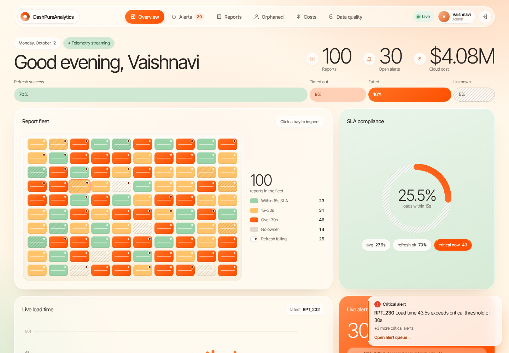
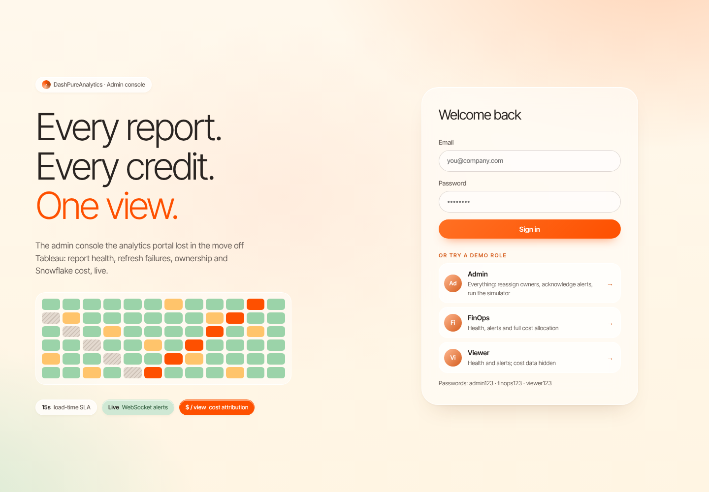
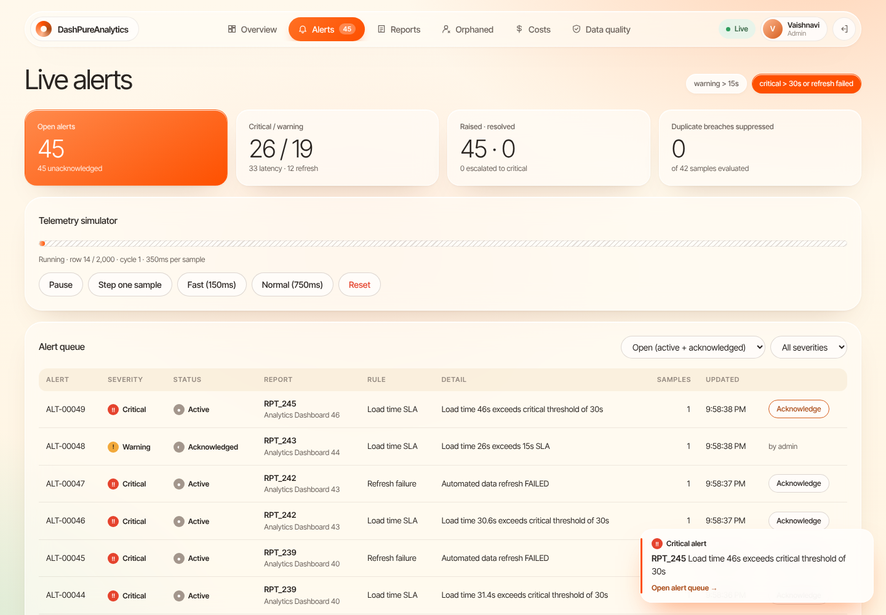
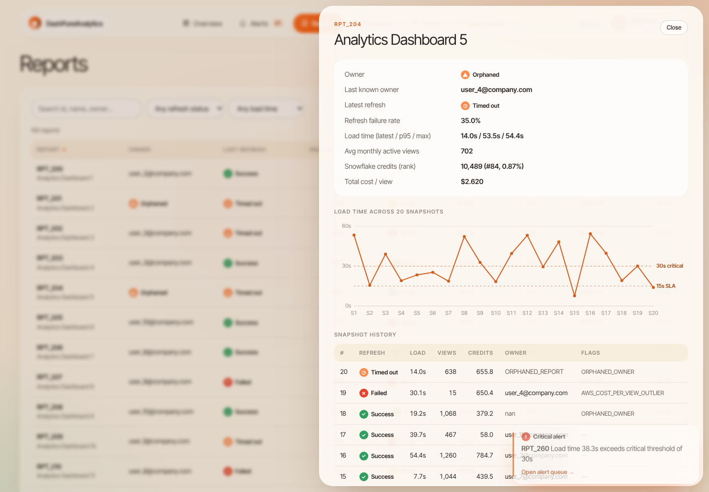
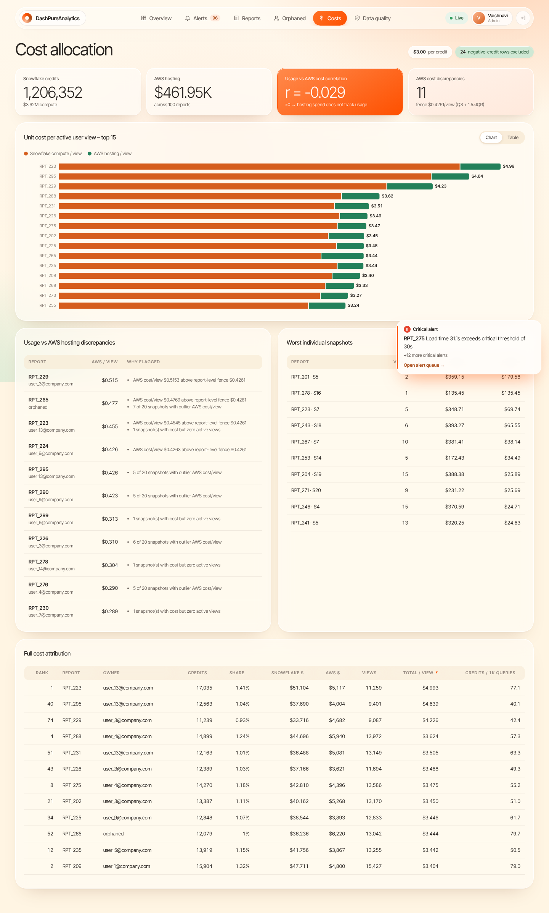
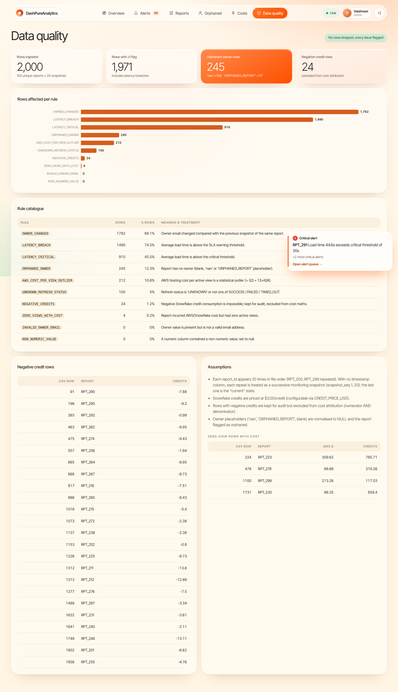
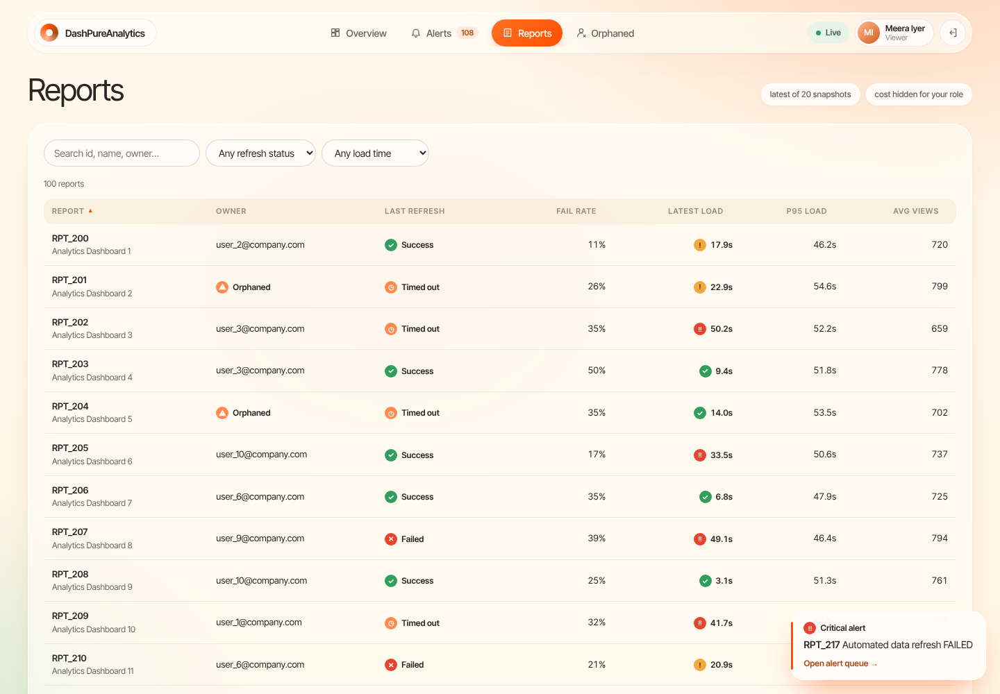
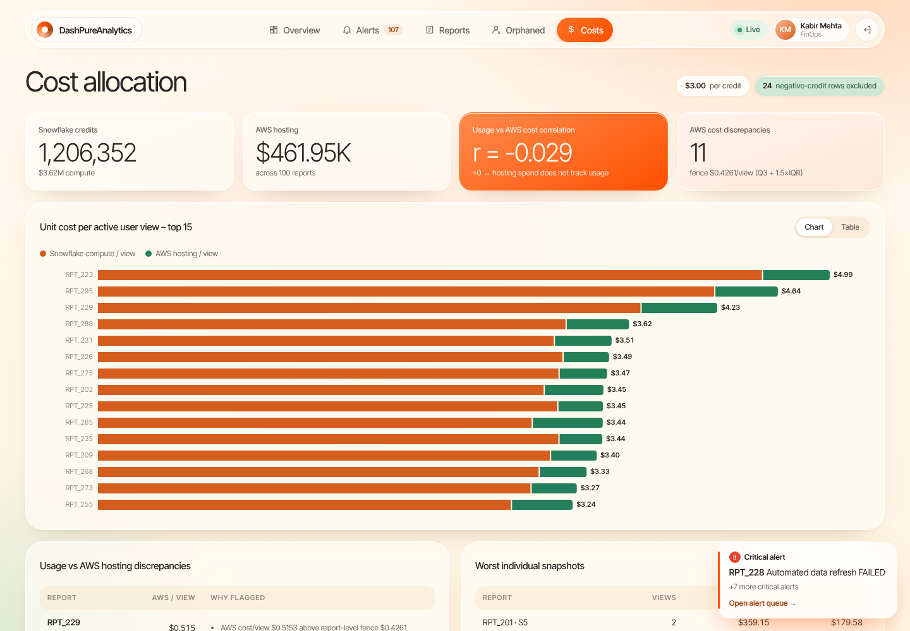

# DashPureAnalytics

**Case Study 3: Technical Data AI Validation – Monetization**

Demo video: _add link here_  
Live app: _add link here_

## About the project

The idea for this project came from a simple problem. A company had moved its analytics portal away from Tableau Server and onto its own stack using React, Node.js, Snowflake and AWS. After the move, it lost some of the admin features Tableau had provided, making it harder to tell which reports were slow, which refreshes had failed, who owned each report and how much the reports cost to run.

I built DashPureAnalytics as a dashboard to bring that visibility back. It covers 100 reports and lets admins check report health, view live alerts, find reports without an owner and look at Snowflake and AWS costs. I also added separate access for Admin, FinOps and Viewer roles, along with data cleaning and data-quality checks.



## Running it locally

You'll need Node.js 18 or newer. Python is optional and is only needed if you want to run the SQL tests locally.

From the project folder, run:

```bash
npm run setup
npm start
```

Once it starts, open http://localhost:4000. You can use one of the demo accounts on the login page.

For testing, the demo accounts are:

- **Admin** — `admin@company.com` / `admin123`. Can manage owners and alerts, control the live feed and view data-quality results.
- **FinOps** — `finops@company.com` / `finops123`. Can view report health, alerts and cost information.
- **Viewer** — `viewer@company.com` / `viewer123`. Can view report health and alerts, but can't see cost data.

A few other commands that may be useful:

```bash
npm test
pip install duckdb pandas && npm run sql:test
```

The first command runs the backend tests. The second runs the SQL files against the CSV data using DuckDB. If you're developing the frontend and backend and want live reload, use `npm run dev:backend` and `npm run dev:frontend` in separate terminals.

You can change settings such as the Snowflake credit price and alert thresholds through environment variables. The available examples are in [`backend/.env.example`](backend/.env.example).

## Deploying

There's a `render.yaml` file in the repository, so the app is set up to be deployed through Render's Blueprint flow. In Render, choose **New → Blueprint** and select this repository. The website, API and live alerts are configured to run as one service.

On Render's free plan, the service may go to sleep after a period without activity. The first visit after that can take around a minute to wake up.

## What's included

The frontend is in [`frontend/`](frontend), and the API and application logic are in [`backend/`](backend). The backend includes role-based access, REST endpoints, WebSocket updates, data cleaning, alert handling and automated tests. The `sql/` folder contains the Snowflake SQL files, and `docs/` contains the API specification and screenshots.

The main pages are:

- **Overview:** Shows the health of all 100 reports in a tile layout. Green indicates a fast report, amber means it's slow, and orange means it's very slow. Striped tiles mark reports without an owner, while a red dot indicates a failed refresh. The page also includes the SLA summary, load-time chart and live alert feed.
- **Alerts:** Lists open alerts, lets an admin acknowledge them and provides controls for the live data feed.
- **Reports:** Lists all reports with search, filters and sorting. Selecting a report opens its history.
- **Orphaned:** Shows reports that don't have an owner, with the most expensive ones first. Admins can assign an owner from this page.
- **Costs:** Breaks down Snowflake and AWS costs by report, including cost per view, and highlights cases where hosting cost doesn't line up with usage.
- **Data quality:** Lists the issues found in the source data and how they're handled.

## How the live updates work

The source data is a fixed snapshot rather than a live feed. To demonstrate live behaviour, I added a simulator that sends the rows through one at a time. Each row is processed by the alert engine, and any resulting alert is sent to open browsers over WebSockets. The frontend also sends its own page-load timings through the same flow.

At a high level, the React dashboard calls the Express API for data and authentication. The API checks the user's role, while WebSockets handle live updates. The data is cleaned and summarised before being served, and the simulator feeds samples into the alert engine.

## A few decisions I made

**I didn't want slow reports to create endless alerts.** Almost three out of four loads in this dataset take more than 15 seconds. Creating a new alert for every slow load would make the alert list noisy, so each report gets an alert when it first crosses the limit. The alert is upgraded if the report gets worse than 30 seconds, and it closes automatically when the report recovers. Across a full run, 2,054 slow-load and failed-refresh events become 847 alerts, with 622 repeated events skipped.

**I kept bad rows instead of deleting them.** Rows with negative credits or missing owners are still useful for investigating data quality. I kept them and tagged the problems. Rows with invalid credit values are excluded from the cost calculations, and the Data quality page shows which rows were affected.

**Invalid credits shouldn't make a report look cheaper.** When a row has negative credits, I exclude both its credits and its views from the cost-per-view calculation. Excluding only the credits would make the report look artificially cheap.

**The SQL and backend calculations need to agree.** I implemented the cost calculations in both SQL and the backend, then added tests to compare the results. That caught a rounding difference: JavaScript produced `$179.57` where SQL produced `$179.58`. I adjusted the rounding so the two versions return the same result.

**Permissions are enforced on the server.** Viewer accounts don't just have cost figures hidden in the interface; the server doesn't send those figures to them. This also applies to WebSocket updates. The tests check access to the different pages for each role.

**WebSocket connections are authenticated too.** Since browsers can't send the usual login header when opening a WebSocket, the login token is passed in the connection URL. The server checks it during the handshake and rejects invalid or missing tokens before sending updates.

**I made an assumption about repeated report IDs.** The data has 2,000 rows representing 100 reports, with each report appearing 20 times and no date column. I treated the rows as snapshots in file order, with the last one representing the current state. Since the source doesn't confirm that ordering, I documented the assumption in the project and on the Data quality page.

**I used SVG for the charts.** Drawing them directly kept the app lightweight and gave me more control over the report tile layout. I also made sure status isn't communicated by colour alone, so icons and labels are included too.

## The SQL and cost calculations

The SQL files treat the CSV as Snowflake usage data and calculate costs for each report. Files 01–07 can also run with DuckDB, so you can test most of the logic locally without a Snowflake account.

Here's what the files cover:

- `00_snowflake_setup_and_load.sql` creates the database and loads the data. Columns are initially loaded as text so invalid values don't break the import.
- `01_raw_table_and_cost_config.sql` creates the raw table and a settings table for the price per credit.
- `02_stg_clean_view.sql` cleans the rows and flags data issues.
- `03_data_quality_audit.sql` counts the rows affected by each issue.
- `04_credit_attribution.sql` calculates credits and dollars per report, along with each report's share and rank.
- `05_unit_cost_per_view.sql` calculates cost per view.
- `06_usage_vs_aws_cost_discrepancy.sql` identifies reports where AWS cost doesn't match usage.
- `07_orphaned_reports_and_health.sql` summarises current report health and lists reports without owners.
- `08_production_account_usage_template.sql` is a template for using real Snowflake usage tables once queries are tagged with report IDs. It isn't run as part of this demo.

The cost-per-view calculation works like this:

```text
Snowflake cost per view = (valid credits × $3 per credit) ÷ views on those same rows
AWS cost per view       = AWS hosting cost ÷ all views
Total cost per view     = Snowflake cost per view + AWS cost per view
```

For example, if a report used 100 valid credits and had 500 views, its Snowflake cost per view would be `(100 × $3) ÷ 500 = $0.60`. That's also 0.2 credits per view. If a report has no views, its cost per view is left blank instead of dividing by zero.

## Issues I found in the data

A few things stood out while working through the dataset:

- **Missing owners:** 245 rows have no owner, affecting 14 reports in the latest snapshot. These reports are marked as orphaned so an admin can assign an owner. The last known owner is suggested.
- **Negative Snowflake credits:** 24 rows have negative credit values. They're kept for review but excluded from cost calculations.
- **Slow loads:** 1,490 rows have load times above 15 seconds, with some taking as long as 55 seconds. These are used by the alert logic.
- **AWS cost differences:** 11 reports are flagged because their hosting cost doesn't match their usage.
- **Unknown refresh status:** 100 rows have a refresh status of `UNKNOWN`. I leave these out of the refresh failure-rate calculation.
- **Repeated report IDs:** 1,900 rows are additional appearances of report IDs, which I treated as snapshots because the dataset doesn't include timestamps.
- **Changing owners:** Owner information differs between snapshots in 1,782 rows, so ownership can't be treated as reliable over time.

## What the results show

The data points to a few areas worth addressing:

- 74.5% of loads take longer than 15 seconds, and the average load time is 27.9 seconds.
- Roughly three in ten refreshes fail or time out.
- Fourteen reports don't have an owner, including some that are expensive or slow.
- Estimated cloud cost is about $4.08 million: $3.62 million for Snowflake and $0.46 million for AWS, assuming $3 per Snowflake credit.
- AWS hosting cost doesn't appear to track usage closely. In one snapshot, a report with two views had $359 in hosting cost, or $180 per view.

If I continued working on this, I'd start with the 43 reports that currently take more than 30 seconds. I'd also make report ownership mandatory before publishing a report, tag Snowflake queries with report IDs so costs can be attributed more accurately, and review AWS hosting capacity against actual usage.

## Assumptions and limitations

A few parts of the analysis rely on assumptions because of what's available in the dataset:

- Each report appears 20 times, and I treated file order as the order of snapshots.
- Snowflake credits are priced at $3 each, but this can be changed in the settings.
- I use the `monthly_active_views` column to represent active user views.
- A load must take more than 15 seconds to trigger an alert. Exactly 15 seconds doesn't trigger one. The 30-second critical threshold is an additional choice I made.
- Owner changes made through the app are stored in memory, so they reset when the server restarts.

## Project structure

The main folders are organised like this:

```text
backend/
  data/          CSV source data
  src/
    auth/        Login, roles and cost-data permissions
    data/        Cleaning, summaries and cost calculations
    alerts/      Alert engine and live-data simulator
    routes/      API endpoints
    websocket.js Live updates
  test/          Backend tests

frontend/src/
  pages/         Application screens
  components/   Shared components and charts

sql/             Snowflake SQL files and local test runner
docs/            API specification and screenshots
```

## Screenshots

**Login and overview**




**Alerts and report details**




**Costs and data quality**




**Different role views**




## What I'd improve next

If I had more time, I'd connect the app directly to Snowflake instead of relying on a CSV snapshot, replace the demo accounts with the company's single sign-on, and send critical alerts to email or Slack as well as to report owners. I'd also save owner changes in the database so they survive restarts, and add frontend tests and an automated test run through GitHub.
